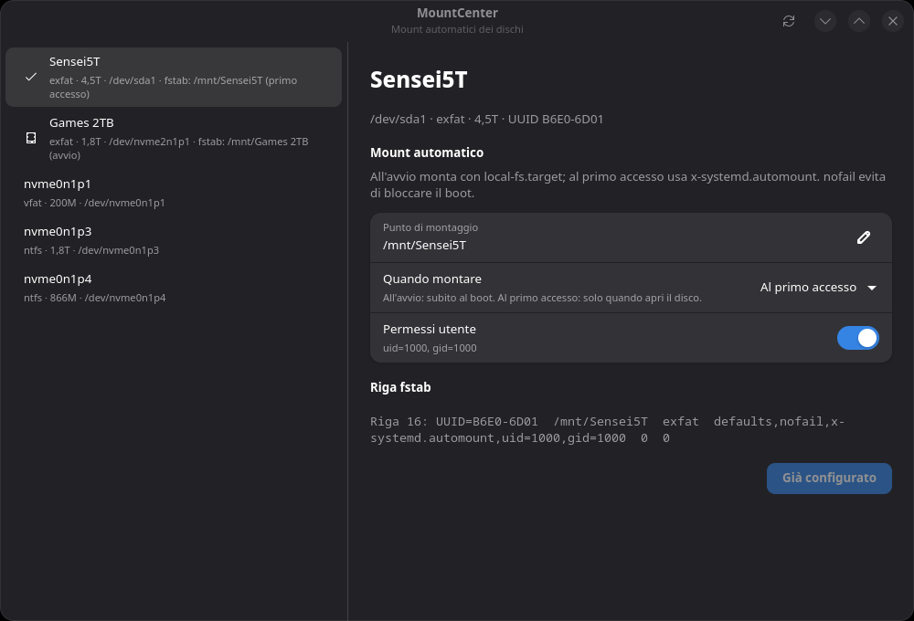
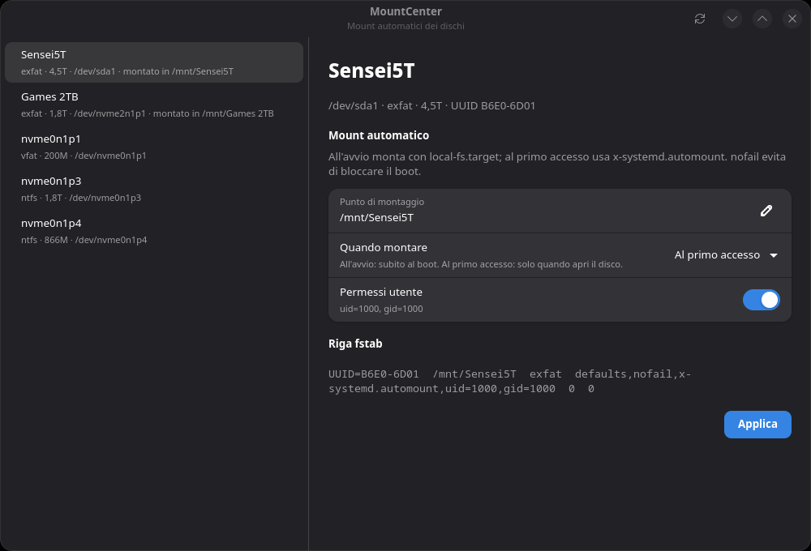

# MountCenter

Configure systemd automount entries in `/etc/fstab` for internal and external
disks on Fedora, without hand-editing the file.

Two front ends share the same rules:

- `mountcenter` — GTK4/libadwaita application, for normal desktop use.
- `setup-automount.sh` — legacy interactive root script, for headless use.

Both derive the UUID with `blkid`, write a line with `nofail` and
`x-systemd.automount`, escape spaces and tabs in the mount point (`\040`,
`\011`), refuse duplicate UUIDs and duplicate mount points, back up
`/etc/fstab`, reload systemd and verify that the generated mount unit exists.



Selecting a disk that is not configured yet shows an editable mount point, the
automount and permission switches, and the exact fstab line before applying:



## Install

From a release package:

```bash
sudo dnf install ./mountcenter-*.rpm
mountcenter
```

From the source tree:

```bash
sudo ./install.sh
mountcenter
```

`install.sh` installs under `/usr/local` (override with `PREFIX`, stage with
`DESTDIR`). The GUI never writes to `/etc/fstab` directly: it calls
`mountcenter/helper.py` through `pkexec`, and the helper revalidates everything
as root.

Legacy script:

```bash
sudo ./setup-automount.sh
```

## Using the GUI

1. Pick a partition from the list; mounted and already-configured disks are
   labelled.
2. Edit the mount point (default `/mnt/<label>`).
3. Choose automount and, for exfat/vfat/ntfs, user permissions.
4. Check the fstab preview, then press **Applica**.
5. Authenticate with polkit. On success the list refreshes.

Entries already present in `/etc/fstab` are shown read-only; entries with
automount configured carry a check icon in the list. Removal is available
through the helper:

```bash
sudo mountcenter/helper.py remove --uuid FE7B-D8D1
```

## Compatibility

Tested in containers by [`.github/workflows/compat.yml`](.github/workflows/compat.yml)
(core, helper and GUI startup under Xvfb):

| Distribution | Status |
|---|---|
| Fedora 44 / 45 | tested |
| Debian 13 (trixie) | tested |
| Ubuntu 24.04 LTS | tested |
| Arch Linux | tested |
| openSUSE Tumbleweed | tested |

Requirements: a systemd-based distribution, Python 3.10+, GTK 4,
libadwaita 1.5+, polkit with `pkexec`, and util-linux. Distributions without
systemd are not supported, because `x-systemd.automount` is systemd-specific.
Ubuntu 22.04 and Debian 12 ship libadwaita older than 1.5 and are not
supported.

Dependencies by distribution, when installing from source:

| Distribution | Packages |
|---|---|
| Fedora | `python3-gobject gtk4 libadwaita polkit util-linux` |
| Debian / Ubuntu | `python3-gi gir1.2-gtk-4.0 gir1.2-adw-1 polkitd pkexec util-linux` |
| Arch | `python-gobject gtk4 libadwaita polkit util-linux` |
| openSUSE | `python3-gobject gtk4 libadwaita typelib-1_0-Gtk-4_0 typelib-1_0-Adw-1 polkit util-linux` |

## Remembered authorization (first launch)

On the first start, when the polkit policy is installed, MountCenter offers to
remember the authorization. Accepting asks for the password once and writes
`/etc/polkit-1/rules.d/50-mountcenter.rules`:

- it applies only to the action `io.github.senseikiritof.MountCenter.manage`,
  i.e. to the MountCenter helper run through `pkexec`;
- only to the user who accepted, and only in an active local session;
- it is not a general `sudo` permission and can be revoked at any time.

Revoke it with:

```bash
sudo mountcenter/helper.py trust off
mountcenter/helper.py trust status
```

Without the rule, every apply asks for the password. In a source-tree run
(no installed policy) the trust prompt is skipped, because the custom polkit
action does not exist yet.

## Architecture

```
mountcenter/core.py    pure logic: fstab parse/render, escaping, validation
mountcenter/helper.py  privileged CLI: apply/remove/status/trust, backup, systemd
mountcenter/app.py     GTK4/libadwaita interface
data/                  desktop entry and polkit policy template
tests/                 unittest suite (stdlib only)
Containerfile.test     Fedora container with GTK, xvfb and a private D-Bus
```

Helper commands:

```bash
mountcenter/helper.py status
sudo mountcenter/helper.py apply --uuid UUID --mount-point "/mnt/Data Disk" --fstype exfat --uid 1000 --gid 1000
sudo mountcenter/helper.py remove --uuid UUID
mountcenter/helper.py trust status
```

All commands print JSON; errors also exit with status 1. `--fstab`,
`--skip-device-check` and `--rule` exist only for tests.

## Build and test

```bash
make test
make rpm            # dist/mountcenter-<version>-*.rpm
make dist           # source tarball from HEAD
```

In the dedicated Fedora container (core, helper and a GUI smoke test under
Xvfb with a private D-Bus):

```bash
podman build -t mountcenter-test -f Containerfile.test .
podman run --rm -v "$PWD":/src:Z -w /src mountcenter-test \
    bash -lc 'dbus-run-session -- xvfb-run -a python3 -m unittest discover -s tests -v'
```

The helper tests run against a temporary fstab file: no test touches the real
`/etc/fstab`. Systemd verification is skipped automatically when the target
is not `/etc/fstab` or PID 1 is not systemd.

Releases are built by [`.github/workflows/release.yml`](.github/workflows/release.yml)
on `v*` tags: tests, RPM in a Fedora container, then one GitHub release with
the package and the source tarball.

## Roadmap

See [docs/interface-plan.md](docs/interface-plan.md). Implemented: core logic,
privileged helper, GUI with first-launch trust, install script, RPM and release
workflow. Pending: removal and automount status in the GUI, dedicated polkit
policy refinements, Debian/Arch packages.
